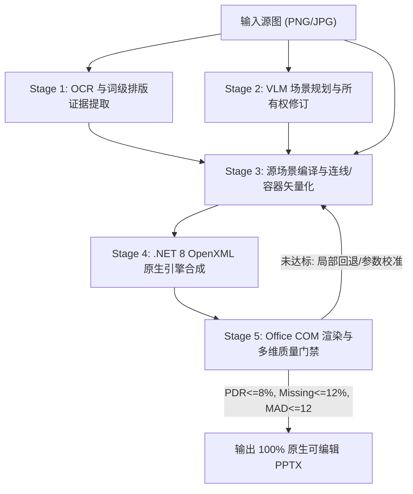

# 图片转可编辑 PPT 方案、架构与审计文档（2026-10-21 更新）

> **完整原生线网更新（2026-10-26 本地时间）**：[当前验证记录](image-to-editable-whole-native-network-20261027.md)已核查正常入口真实原图回放、实际 PPTX XML 和 LibreOffice 渲染：11/11 条业务关系均为单条双端绑定的原生连接器，两组线网的有序路径与保留分支匹配，下层采样闭环保留。PDR 7.9900644%、前景缺失 2.5831213%、MAD 8.6736686，原门槛未变；这不是 PowerPoint 交互验证。严格语义仍有大栅格来源失败，桌面截图和可访问性均不可用，整页未验收、共享 Worker 未部署。真实线网 writer 回归已补入统一契约分类；全量测试终态及语义优先诊断预览继续见当前记录。下方旧 9/12、分段连接器及旧成品状态按原轮次保留。

> **最新：局部外框近似验收与工程 CI 完成（2026-10-23）**：[当前外框结论](image-to-editable-approved-frame-acceptance-20261023.md)已确认正常 v6 的 n4/n6/n8 两模式共 6/6 项移动、保存关闭重开及完整旧周长近似外观通过，正常比例无可辨旧框或连续白缝；放大纸纹过渡仍为近似。实际 Office 静态 PDR 7.725140665%/7.847300652%，新增超差 326/323、恢复 15/18，原数值阈值未变。原严格同侧差 6、582/578 条拒绝及 9/12 区域、11 关系保持；整卡、整区与整页仍未通过。独立组合 8/8、24 fixture 图及12真实图逐RGBA通过，真实6目标/1alias与fixture6alias分开报告。[预算及终止修复](image-to-editable-worker-budget-repair-20261023.md)的完整原入口 CI 已退出0，2492项工程输入及814/34/94文件清单终检不变；原705项扩大源码Lint错误仍保留。CI不认证隔离外框模块，候选未迁生产，共享Worker未激活。下一包聚焦n10整卡源归属与分组，不能只改groupId；旧映射的OCR tuple分桶错误保留并另行修正。下方v4/v5视觉失败与CI v2失败均是未覆盖的历史证据。

> **n10 诊断补充（2026-10-23）**：[OCR 分类更正](../.codex-temp/approved-approx-frames-20261023-v1/fit-candidate/whole-page-gap-map-v2/CORRECTION.md)已用显式 tuple/object/缺省/非法解析修正 v1，3项独立临时回归通过。旧分桶废止，8124总数及14对象等整页事实保持。auto单模式正常冻结主链已观察真实live parent，8124残余中3551位于已接纳周长、7869位于body几何；body不授paint/glyph归属，完整唯一paint及旧位置背景尚未证明，授权转移为0。最终14对象逐字段保持、0新模型/OCR/Office，没有实施分组或擦除。不能用序列化ID、颜色分类或分组字段替代该前置；整卡尚未通过。

> **获准近似外框，发现并保留视觉失败（2026-10-23）**：用户已同意 n4/n6/n8 依据可见边段拟合，严格结果另保留。[隔离候选索引](../.codex-temp/approved-approx-frames-20261023-v1/README.md)记录正常主链 v4 的两模式输出、实际 Office 渲染和6/6项逐框移动保存关闭重开。实际PPTX只改变目标平移，其余XML/media保持，静态PDR为7.725904%/7.848191%；8项组合回归及逐RGBA复核通过。但是四边/角点完整视觉审阅发现透明擦除显露的白色接缝，165个原rail样本仍有栅格paint，因此v4明确不通过无残影验收，正在独立修复背景衔接。严格仍9/12、关系11条，不能改称12/12完整区域；临时候选尚未迁入生产或统一CI，共享Worker未变。

> **独立安装真实引擎解析修复及CI失败终态（2026-10-23）**：[本轮记录](image-to-editable-native-installed-resolution-20261023.md)已用 sibling Core manifest 上的标准 createRequire 修复80文件、178处导入，实际无内部工作区别名Linux三类消费、两模式冻结回放和Release writer通过且输出等价。CI v1负对照fixture缺失新冷加载阶段已修复；v2封存2492项输入，814 unit和34 contract通过，94 integration文件全部执行，但并发预算与真实进程树终止两条时限测试失败，耗时3792839ms、退出1。Python lock和新包安装消费未执行，旧失败保留；后续修复另存 `worker-budget-determinism-20261023-v1/`。原配置Lint通过，扩大源码Lint仍有705项既有errors且0新增，不称全绿。此项工程修复不证明上方隔离近似候选，也未激活共享Worker。

> **隔离 Linux 运行验证（2026-10-23）**：[本轮记录](image-to-editable-isolated-linux-worker-20261023.md)补齐当前代码的独立运行证据：三类消费者在原时限返回 ready，两模式真实截图冻结回放及 Release writer 通过；每模式30项图像、仅归一化随机资产路径的完整Deck，以及去时长后的完整scope与Windows一致，实际PPTX每个ZIP条目内容也相同。2490项CI工程输入及全部隔离包/依赖摘要保持。保留缺依赖、挂载消费60秒超时和缺工作区链接三次诊断失败；最终形态显式建立20项内部工作区链接，不外推为独立tar真实引擎安装验收。断网临时容器已移除，共享Worker状态不变。新图摘要仍绑定原全RGB一致报告；没有新OCR/VLM、Office、完整CI或生产代码修改。仍11关系、9/12区域、整页产品未过，外框近似重建标准选择待答复。

> **完整残差共享原线去重（2026-10-23）**：[本轮记录](image-to-editable-shared-residual-union-20261023.md)已将完整私有共享组件接入本地源码，按旧擦除∪S追加，净新增透明1254/1753点；S外RGBA变化和旧透明恢复均0，其余29图及完整规范化Deck/scope保持。真实Office两模式整组移动8pt/5pt、保存关闭重开通过，新增位置近源色残影1037→29 / 1458→31，完整XML仅两组平移。静态PDR为7.705364%/7.827905%，保留新增失败237/701及恢复45/46；原门槛未变。33项生产定向回归及原架构预算通过；CI v1在contract发现required清单缺项，已新增23项依赖义务，保留旧失败。补强非零owned文字交叠断言后的动态定向18/18通过；完整CI v2退出0，940文件、11分片及真实包安装消费全部通过，2490项派发前源码摘要终检保持。最终正常生产回放的30/30资产、完整Deck/scope与Office候选等价，161项独立主输入封存。有界文字诊断及补强回归保持完整union合同。实际IR/PPTX复核确认两模式全部关系路径及1个闭环保留，n201不再碎成多段。新附件再次确认全部RGB像素相同。仍11关系、9/12区域和整页产品未通过，Worker未激活；本段下方1254/1753完整残留为修复前历史结果。

> **共享局部底图去重（2026-10-23 UTC）**：[本轮记录](image-to-editable-shared-crop-deduplication-20261023.md)已将单模块修复迁入本地生产源码：局部透明化现在同时读取完整共享线网的既有私有源证明。净新增擦除706个像素、只改3张图；1045是含既有339的账本总数。真实Office两模式整组平移8pt/5pt、保存关闭重开后，本次706位置的近源线颜色残留533→13 / 551→9，独立完整XML只见两组平移。静态PDR略退至7.693154%/7.786252%，保留新增失败146/320及可重路由41个未匹配前景点，原门槛不变；不能全部归为AA。生产正常双模式回放与隔离Office候选的30项资产字节、完整规范化Deck和scope相同，18/18定向回归、811文件完整unit、Lint、两套类型和原架构预算通过，136项绑定终检保持。完整residual仍1254/1753、3张split映射未知；仍11关系、9/12区域，整页产品未过，Worker未激活，本补丁未运行完整CI。

> **背景保留隔离候选（2026-10-23 UTC）**：[完整记录](image-to-editable-background-preservation-20261023.md)重新确认本次附件与冻结源全部RGB像素相同。新的set-minus候选在两模式仅从原擦除中恢复4767/4119个exact-source像素、0新增擦除，形状/文字/其他29项图像及完整语义报告保持；22/22隔离回归通过。实际writer/Office的PDR轻微净改善至7.685650%/7.766030%，同时保留5/7个新增均差>24点和22/20个恢复点。主要白缝、原线重复和整卡缺项保持；综合收益与维护成本不合入生产，不新增零退步产品硬门槛，不继续同候选参数枚举。仍为11条关系、9/12区域和整页未完成；本轮无新生产补丁、完整CI或Worker激活。

> **共享残差候选与数组边界（2026-10-23 UTC）**：[隔离候选复核](image-to-editable-shared-residual-review-20261023.md)确认 v5 实际 Office 新增 248/716 个均差>24失败点，本轮不合入 exact-source residual 实现；全部隔离源码和渲染保留，门槛未变。[独立数组修复](image-to-editable-array-boundary-20261023.md)在共用 list 拒绝稀疏数组的方法/Symbol 补位，并提前拒绝顶层代理。14/14 定向、完整 810 文件 unit、Lint、两套类型、原架构预算通过，5 项源码/测试绑定保持；本轮没有新的完整 CI。正常两模式回放的原生形状、文字、30 张图片实际字节及完整区域/语义报告保持，仍为 11 条关系、9/12 区域和严格整页未通过。本次附件再次完整解码仍与冻结源全像素一致。未激活共享 Worker，未运行新的 Office/整页编辑验收；该安全修复不计为产品区域或视觉进度。

> **弯线残差误擦修复（2026-10-23 UTC）**：[本轮记录](image-to-editable-residual-connector-geometry-20261023.md)已修复开放自由路径/原生折线被误按外接框对角线擦除的原因，仅将旧擦除与实际绘制走廊求交，不新增源擦除。最终正常两模式回放完整残差分别恢复 4869/4715 个原图像素，0 新增透明洞；实际 writer/Office 及独立全像素、ZIP/XML 复核通过，两包均仅 residual 图片条目改变，全部绘制 XML、其他图片资产、组和连接保持。原 PDR 为 7.686731%/7.766857%，确认白楔恢复，其他白缝及原曲线重复 paint 保留；43/43 定向回归及两套类型通过，完整 CI 已于 12:20:08 UTC 退出 0，实际运行包安装消费通过且绑定输入未变。严格 semantic/native-component 全报告不变，仍为 11 条关系、9/12 区域，整页产品未通过，Worker 未激活；该 CI 不用于后续新修改。

> **填充关系完整原生分组（2026-10-23 UTC）**：[本轮记录](image-to-editable-filled-grouping-20261023.md)已让 `relation-regional-0-0` 的两块填充主体及两条实际连接片段在两种模式正常回放中保留为四成员组。真实 writer/Office 整页与各自基线均为 0 像素变化；独立检查全部 325/335 个绘制 XML、75 个既有组及实际媒体字节保持。两种模式整组移动 8pt×5pt、保存关闭重开通过，独立 XML 仅允许组 off 改变，32/68 个连接引用保留；这不证明填充关系自动重路由或整卡分组。15/15 最终定向回归、Lint、两套类型及原架构预算通过，本轮完整 CI 于 11:04:17 UTC 退出 0，936 个测试文件、11 分片及实际运行包安装消费全部通过，独立终检确认 16 项关键绑定未变。新 JPEG 与冻结 PNG 全部 RGB 像素一致，仍为 11 条关系、9/12 区域，两种模式完整严格 semantic/native-component 报告与各自原基线完全相同，整页产品验收未完成，Worker 未激活。

> **完整法向截面复核（2026-10-23 UTC）**：[本轮记录](image-to-editable-continuous-sections-20261023.md)保留全部 220 个原路径样本及 188 个线身样本；现有扫描线背景下仍有 4 个线身截面未满足双侧背景条件，位于节点接触及分区边界附近。独立 Python 从原像素、完整组件和几何重新验证全部截面与 5568 项背景查询，30 项输入绑定保持；本次 JPEG 与冻结 PNG 的 1,572,528 个 RGB 像素再次全部一致。完整长截面可能混入其他对象，不能直接推断线宽错误、移动参数或源归属；没有新候选、生产补丁或 Office 重跑。当前仍为 11 条关系、9/12 区域和整页严格验收未完成。

> **共享线网完整分组与新图复核（2026-10-23 UTC）**：[本轮记录](image-to-editable-shared-grouping-20261023.md)完成正常回放、真实 writer、Office 整组移动 8pt×5pt、保存关闭重开及独立完整 XML 检查。默认 `auto` 两组为 4/36 成员，可重路由模式为 4/46；全部组内成员、连接引用及外部对象保持，两种模式整页渲染与各自基线均为 0 像素变化。新 JPEG 与原 PNG 全部 RGB 像素完全相同。最后修改后 21/21 定向回归、Lint、两套类型和架构预算通过，完整 CI 的 935 个测试文件、11 个分片及实际运行包安装消费全部通过，15 项关键绑定不变；11 条关系、9/12 区域、整卡和原外观缺项保持，共享 Worker 未激活，整页产品验收仍未完成。

> **连线覆盖偏差独立复核（2026-10-23 UTC）**：[本轮归因记录](image-to-editable-centerline-render-attribution-20261023.md)独立重建全部 346 个回退，264 在线身、23 在箭头、59 在原关系外；最长水平段 107/107 完整横截面及其 232 个回退全部保留。源/Office 投影覆盖中位数 3.342197/3.024184，配对质心差中位数 0.422466px，仅属诊断，不能直接转为平移参数、归属或新增逐像素验收条件。当前新 JPEG 再次完整解码，与原 PNG 的 1,572,528 个 RGB 像素完全相同。原 3469 项绑定已复核；没有生产补丁、新候选或 Office 重跑，11 条关系、9/12 区域及原缺项保持。

> **联合细线候选关闭（2026-10-23 UTC）**：[完整源组件与实际 Office 复核](image-to-editable-joint-centerline-review-20261023.md)核对原 3435 项绑定，并用当前模式重新生成同批基线。原未解释 681 cells 中有 35 位于完整关系组件内，仍余 646；目标 cell 的原路径必要偏移 0.773498px 超出 0.75px。独立原生细线加既存阴影候选虽使目标误差回到 18，但完整影响范围新增 346 个超差像素，未接纳。实际 13 条连接器均双端绑定，3442 项输入及全像素独立核验通过；无生产补丁、源擦除或 Worker 激活，11 条关系、9/12 区域及原成品保持。

> **原生连接器链生产实现（2026-10-23 UTC）**：[本轮记录](image-to-editable-native-chain-production-20261023.md)已把隔离原型实现为有输入校验、独立预算实例及整网拓扑检查的生产模块，仅用于闭环 `reroutable-elbow`。真实生产冻结回放从 6 条恢复到 11 条关系，默认 `auto` 全部绘制属性及 31 项资产字节不变；完整区域仍为 9/12。实际 writer、Office 渲染及六端点各移 8pt 的保存重开通过，6/6 带动连线，PDR 7.812770%；未移动完整卡片，原擦除/边框瑕疵及整页门禁缺项保留。新定向回归 35/35、完整 CI v10 的 932 测试文件、实际安装及六类能力消费全部通过，2459 项绑定未变。共享 Worker 未激活。以下“生产仍为 6 条”及“仅为原型”为各轮历史状态。

> **颜色修复与连接器链原型（2026-10-23 UTC）**：[本轮完整记录](image-to-editable-native-chain-prototype-20261023.md)修复重复核心采样位置被补造成渐变的问题；完整 CI v9 的 928 个测试文件及运行包安装消费通过，2452 个绑定未变。生产默认模式保持 11 条关系、9/12 区域；生产可重路由模式仍为 6 条。另一个进程隔离原型以 26 条原生连接器恢复全部关系，实际 Office 六端点移动跟随、保存重开全部通过，5 条有序路径及闭环保留，数值 PDR 7.812770%。该原型尚未进入生产，其预算/输入边界仍需实现和回归；原外观、完整卡片及整页门禁缺项保留，不能把 CI 通过转用于它。

> **端点跟随及模式补充（2026-10-23 UTC）**：[实际端点移动核查](image-to-editable-node-following-20261023.md)在当前成品副本完成六个端点形状向右移动 8pt、保存重开：1 个原生连接器跟随，5 个自由路径端点不跟随；没有移动完整业务卡片。正常回放保持 11 条关系和 9/12 区域；可重路由模式的闭环展开因原路径上限只完成 6 条关系，未启用。固定全部共享节点的只读几何试算中，12 条源边有 5 条可直接拟合，7 条仍需拆分与证明。17 项既有相关回归通过，无生产修改；整页验收仍未完成。

> **共享线网实际编辑补充（2026-10-23 UTC）**：[21 个物理成员格式编辑验证](image-to-editable-shared-editing-20261023.md)在当前端帽成品副本上完成逐项改线宽、保存、关闭重开，几何及 106 个自由路径坐标值保持。真实包中颜色/渐变、端帽和箭头未变，5 条逻辑路径、1 个闭环保留；编辑副本完整 Office 导出通过。此证据不证明节点跟随、原子分组或整页通过，完整区域仍为 9/12。原成品和前轮全部源码绑定保留，无生产修改或共享 Worker 激活。

> **最新状态（2026-10-23 UTC）**：[用户完整关系清单修订](image-to-editable-region-completion-20261022.md)已使正常冻结回放达到 **9/12**，旧观察 12、n200 及全部历史账本保留。[端帽 writer 修复](image-to-editable-native-line-cap-20261023.md)随后通过实际 PPTX/Office 数值视觉检查；共享 21 个物理成员、5 条逻辑路径及 1 个闭环保持。[完整 CI v8](../.codex-temp/goal-engineering-verification-20261023-v8/README.md)已全部通过，含 927 测试文件和实际安装消费，2451 项绑定未变。整页语义、原生组件及编辑验收仍未全部通过，共享 Worker 未激活本地修复；下文 8/12 和 CI 运行中等为相应历史状态。

> **编译输入安全修复（2026-10-23 UTC）**：[校验顺序与 Symbol 属性修复](image-to-editable-compiler-input-20261023.md)关闭完整 CI v7 暴露的两处 getter 回归，并补齐预检和共用对象校验。24 文件、254 项定向回归及完整 CI v8 通过；新冻结回放保持 11 条关系、9/12 区域和全部绘制资产。旧失败保留；整页产品验收仍未通过。

以下更新按时间倒序排列；最新区域结果为 9/12，后续各段的 7/12、8/12 是对应阶段的历史记录。工程验证、IR 回放和权威 PPTX 的 Office 验收各自保留证据范围。

> **端点完整效果候选（2026-10-22）**：[实际阴影及完整组件检查](image-to-editable-shadow-complete-effect-20261022.md)得到一个仅改变阴影 RGB 的隔离候选：实际 Office 全部 10,017 个受影响像素新增超差为 0，1,053 个新增通过，端点误差 18。原节点分量拆出的 1,880 个 cells 中仍有 681 个不能由该阴影单独解释，未授予节点归属或删除源 paint；另一个边框颜色微调候选有两处新增超差，被拒绝。只读观察下正常冻结回放的全部 Deck 数据保持，8/12 区域和原关系清单不变。没有生产补丁或新的整页交付，后续仍需完整联合归属与残差证明。

> **当前同文件 Office 验收（2026-10-22）**：[新整页成品及独立证据](image-to-editable-current-office-assessment-20261022.md)确认实际 writer、完整 Office 导出及两项基础编辑通过；PDR 7.7273%、缺失率 1.9733%、MAD 8.1883，原数值视觉门槛通过。输入与资产 105 个绑定不变，实际 XML 的 21 条共享物理成员各出现一次。完整区域仍为 8/12，两种语义与原生组件仍未通过，预览仍有擦除边缘等绘制瑕疵；自动选取的改字及移动不能代表完整卡片或连线跟随。没有生产代码增量、完整 CI、包安装或 Worker 激活；此前没有新 PPTX/Office 的描述保留为对应历史阶段。

> **完整区域报告修复（2026-10-22）**：[生产接口及本地验证](image-to-editable-completion-diagnostics-20261022.md)将外框未物化、观察清单不一致及原待恢复依赖分开，明确区域编译结果不代表 Office 编辑或视觉验收。新正常冻结回放仍为 8/12，11 条接纳关系与 12 条观察保持，旧形状、69 个文字对象及 30 个图像内容均保留；两个随机资产目录名的差异已用精确身份与字节摘要核对。159 文件、1347 项场景回归、两套类型、定向 Lint 和架构预算通过。四处原产品缺项仍未解决，没有新 PPTX/Office、完整 CI、包安装或共享 Worker 激活。

> **真实锁定安装与六类消费通过（2026-10-22）**：[本轮真实结果](../.codex-temp/runtime-locked-real-candidate-20261022-v3/README.md)复用同一保留候选，npm 离线生成锁 66452ms、实际 `ci` 安装 98349ms，两阶段含校验合计 165330ms，在原合计 600000ms 期限内完成。经严格归档完整性及来源检查的官方锁含 50 项、无链接；锁生成未改写 host 清单，ci 后锁哈希不变。20 个工作区包、六项能力及生产依赖闭包通过。六类消费者均返回严格 `ready`；共享连线完整五场景以新 120 秒 profile 执行，实际 23130ms，其他五类仍为 60 秒，输出上限与全部断言保留。临时安装已清理，2311 个源/输入绑定不变。该共享探针本次也低于原 60 秒，不能将成功归因于时限增加或推断旧超时根因。生产验证器未切换安装方案，完整 CI 未重跑，产品仍为 **8/12**，没有新 Office/PPTX、整页回放或共享 Worker 激活。

> **前序安装实验的额外自依赖已定位（2026-10-22）**：[小样例及源码对照](../.codex-temp/runtime-lock-only-contract-20261022-v5/README.md)确认本地 npm 10.9.8 的 Windows 无目标 `install --prefix` 路径会隐式加入 `.`；在 host cwd 会增加 host 自依赖，在仓库 cwd 可能安装仓库。这补充了此前“workspace 发现”的不完整归因。前序 v7/v8 的候选解包计数及 require 仍为真实观察，但不能单独证明干净依赖闭包。修正后的小样例及上述真实安装均改为独立 host cwd、无 prefix 的无目标命令；根依赖、归档 SHA-512、公共来源及无链接检查均保留。生产验证器显式传入命名 tarball 目标，不走该空目标分支，没有因此改动。原失败、首次真实锁校验拒绝及不独立的同进程 config 控制均保留，未回写为成功。

> **截图来源收束与安装诊断（2026-10-22）**：用户已确认只有当前截图，不再以原始 PPT/PDF、矢量或高清图作为待补材料。[离线解包阶段测量](../.codex-temp/runtime-extract-phase-diagnosis-20261022-v1/README.md)在约 440ms 完成 1849 条目校验，但解包持续推进至 110.6 秒的 1401 条目后，仍在 120 秒截止；这证明本次本地解包慢，不能确定此前 npm 超时的具体阻塞操作。[两个官方锁定安装小样例](../.codex-temp/runtime-locked-install-feasibility-20261022-v7/README.md)及其[本地依赖和特殊路径补充](../.codex-temp/runtime-locked-install-feasibility-20261022-v8/README.md)均真实通过：普通安装对候选包解包 2 次，复用 npm 生成锁的 `ci` 解包 1 次，实际 require 成功且锁不变。前六次预实验失败及观测钩子循环加载错误均保留；未切换真实验证器或重装真实候选，不能声称首装提速、真实依赖闭包或 120 秒共享消费已通过。安装/共享探针期限继续为 10 分钟/2 分钟，其他探针 1 分钟。

> **n111 后绘制遮挡方案关闭（2026-10-22）**：[连续几何独立复核](../.codex-temp/n111-continuous-outline-occlusion-review-20261022-v1/README.md)证明，同产物 n111 完整 outline 与 paint-0 对原 0.123082px² 外露三角的面积交集为 0；实际 PPTX 量化后仍有 0.123521px² 未覆盖下界。不能以现有后绘制轮廓为该片段签发完整归属或分组凭证；这也不等于已证明所有最终图层的可见性。本轮没有生产代码增量、新模型、Office/PPTX、整页回放或共享 Worker 激活，完整区域仍为 **8/12**、已接纳关系 **11 条**、原 owner 观察 **12 条**；目标仍 active。

本轮封存指纹核查另发现早期 root-cwd 小样例造成的一处 CLI shebang 换行变化，与 npm bin-links 的 CRLF→LF 规范化完全相同。已保留异常副本，严格确认唯一差异及归档条目原哈希后恢复原字节；[恢复记录](../.codex-temp/runtime-locked-install-feasibility-20261022-v8/workspace-side-effect-restoration.json)保留该副作用。后续小样例使用独立 host cwd 并关闭 workspace 发现，原工作区源绑定最终逐项复核；这不将前序失败实验改记为有效对照。

下述共享连线期限修复的[补充工程门禁](../.codex-temp/runtime-shared-probe-timeout-20261022-v1/gates.json)已通过两套完整类型检查、架构预算及定向差异检查；临时安装已清理，2311 个绑定未变。该工程通过不改变本轮安装超时及安装后消费者未执行的结论。

> **共享连线期限单独调整及后续安装失败（2026-10-22）**：在下述共享连线 60 秒超时后，[本轮修复与记录](../.codex-temp/runtime-shared-probe-timeout-20261022-v1/README.md)仅为包含五个完整场景的共享连线探针增加闭集 profile，期限为 120000ms；其他五类探针保留 60000ms、4096 字节与严格 `ready`，场景和质量断言不变。35/35 回归、定向 Lint、严格 helper 类型及独立只读复核通过。但同一保留包的新一次安装在 600903ms 后以 `ETIMEDOUT / SIGTERM / status:null` 失败，所有安装后消费者未运行，120 秒实际消费效果尚未验证。该结果不能确认具体 npm 阻塞操作或旧 CI 根因；此前成功及失败记录均保留。没有新产品回放、Office/PPTX 或共享 Worker 激活，完整区域仍为 8/12，完整 CI 未重跑。

> **按用户要求放宽安装期限（2026-10-22）**：[本轮记录](../.codex-temp/runtime-install-timeout-20261022-v1/README.md)仅将 npm 安装从 300000ms 调至 600000ms；32/32 回归、定向 Lint 和严格 helper 类型通过。复用同一保留包的一次安装在 288679ms 成功，Worker 与场景程序探针分别在 29770ms、23146ms 返回严格 `ready`；共享连线探针仍在原 60000ms 期限后以 `ETIMEDOUT / SIGTERM / status:null` 失败，后续三类消费者未运行。2311 个绑定未变，临时安装已清理；此前 CI 与安装失败均保留，不能由这次通过推断旧失败根因。本轮整体仍失败，完整区域仍为 8/12，未新增 Office/PPTX 或共享运行时验收。

> **安装探针诊断修复及独立安装失败（2026-10-22）**：[安全分类回归](../.codex-temp/runtime-probe-classification-20261022-v1/README.md)先红后绿，26/26 通过，定向 Lint、严格 helper 类型和统一 CI 入口检查通过。`runClassifiedProbe` 只委托独立模块，保留 60000ms / 4096 与严格 `ready` 成功条件；超时、信号、退出码及固定阶段均为有界诊断，不保留原始输出、异常或参数。[一次受控安装](../.codex-temp/runtime-installed-probe-diagnostics-20261022-v1/result.json)保留同一新 tarball，打包 58737ms 成功，安装在原 300000ms 期限后返回 `ETIMEDOUT / SIGTERM / status:null`（300297ms）；仅执行到第二个命令，所有安装后消费者均未运行。2311 个源码及输入绑定未变，临时安装已清理；不能由该结果认定第四次 CI 的 Worker 失败也是超时。第四次 CI 仍封存为失败，完整区域仍为 8/12，没有新 Office/PPTX 验收、共享 Worker 激活或部署。

本次补丁后的[补充工程门禁](../.codex-temp/runtime-installed-probe-diagnostics-20261022-v1/gates.json)另通过完整双套类型检查、架构预算及定向差异检查；与上述 26 项回归共同证明本次安全诊断实现，不构成新的完整 CI，也不改变实际安装失败。

> **第四次 CI 终态：最后安装消费失败**：[固定源码结果](../.codex-temp/goal-engineering-verification-20261022-v4/result.json)退出 1，耗时 3,094,525ms，2311 个绑定文件未变。Lint、两套类型、配置、.NET 审计与锁定构建、全部 919 个测试文件（793 unit、32 contract、94 integration）及 Python lock 均通过。缓存发布和共享消费者调度两项原失败已在本轮完整测试中解除。新包已完成打包、安装及前置 CLI 检查，但首个安装后 Worker 探针只报 `unclassified`；旧报告未保留 spawnCode/signal/exitCode，具体进程失败原因尚未确定。后续安装消费者未执行，整轮 CI 仍失败。产品区域保持 8/12，没有本图的新 Office/PPTX 验收或共享 Worker 激活。

> **第三次工程 CI 终态（2026-10-22）**：[固定源码 CI](../.codex-temp/goal-engineering-verification-20261022-v3/result.json)退出 1，2310 个文件绑定保持不变。Lint、类型、配置、安全审计及锁定 .NET 构建通过；794 个 unit 文件全部执行，两个分片分别出现缓存目录发布 `EPERM` 和共享连线消费者子进程无退出码。后续 contract、integration、Python lock 和新包安装消费未执行；不能标为全绿。产品区域仍为 8/12，正在准备独立工程修复，未生成新 PPTX、Office 验收或部署。

> **页脚完整区域修复（2026-10-22）**：[正常冻结主链回放](../.codex-temp/region-icon-completion-20261022-v3/README.md)已将完整区域从 **7/12 提升为 8/12**。用户确认的三根独立短柱经源绑定人工身份凭证、完整组件及首字“5”保护后，输出三条原生路径；69 段文字的内容、排版和原 OCR 身份不变，仅两段新增区域完成元数据。所有旧形状、11 条已接纳关系、12 条原观察及共享闭环深比较不变。唯一残差变化为图标自身的 332 个已证明像素，其余 29 项图像像素相同。其他四处区域仍未完成，整页语义和原生组件门禁仍失败；没有新 Office 或新 PPTX 行为验收，共享 Worker 未激活本地修复。最终工程门禁以本轮固定源码的 CI 终态为准；此前两次 CI 均在已知修复前主动结束，不能计为通过。

> **本地安装根因修复与页脚身份补充阶段记录（2026-10-22）**：实际 npm 模块诊断确认裸 tarball 路径会触发一次额外完整解包以发现包名；运行包验证器现在先校验包名，再使用原始绝对路径的 `common-tools@file:` 参数。[路径修复证据](../.codex-temp/runtime-package-file-spec-20261022-v1/README.md)包含实际 npm 解析器对照及 22 项通过回归；编码 file URL 的失败实现保留记录。[第三次隔离安装](../.codex-temp/connector-mode-installed-20261022-v3/verification.json)使用同一旧 tarball、原隔离条件和原 120 秒期限，一次安装 95.432 秒成功，随后原消费者 11/11 通过；不能据此断言重复解包是前两次超时的唯一原因，该旧包也不包含后续图标修复。该阶段用户已确认页脚三根短柱是独立图标、正文从“5”开始，当时仍为 **7/12**；后续完成源绑定和正常回放后已提升为上方的 **8/12**。目标 active，前一次统一 CI 在源码修复前主动结束，不能计为通过。

> **后续证据收束与区域并发（2026-10-22）**：用户再次要求提高区域并发，当前按虚线外框、页脚图标文字、卡片分组三个工作单元推进；三个外框共用测量算法，由同一路维护，公共接口与整页验收由主线程汇总。[n111 背景候选](../.codex-temp/card-background-producer-20261022-v1/verification.json)因缺少格内连续片段归属证明已关闭，不能用同一 perimeter cell 或 producer 来源凭证直接放行。[加强隔离后的第二次安装](../.codex-temp/connector-mode-installed-20261022-v2/verification.json)仍在原 120 秒截止时超时，功能 probe 未执行，具体 npm 阻塞操作尚未证实。原 `relation-n200` 的 header 未保留，12 条 owner 级观察没有逐条物理身份，不能用计数差补原 ID。完整区域仍为 **7/12**；这些诊断没有生产修复、区域增量或共享 Worker 激活。

> **最新并发复核（2026-10-22）**：按用户授权分三路核查完整旧描边、卡片分组位置与模式运行边界。三张卡片都存在相互矛盾的绘制先后要求，不能仅移动组位置解决；完整旧描边和 n111 旧背景也尚未取得安全退役或私有成员证明，详见[业务分组复核](image-to-editable-component-paint-conflicts-20261022.md)。本地模式回归 30/30、打包文件面检查通过，但[实时只读核查](../.codex-temp/connector-mode-readonly-20261022-v1/verification.json)确认共享 Worker 仍运行旧镜像。另行新增的[三模式隔离安装验证](../.codex-temp/connector-mode-installed-20261022-v1/verification.json)在原定 120 秒离线安装截止时超时，功能 probe 未执行；该次失败不回写为安装消费通过，也不改变下文先前不同批次的验证记录。本轮没有生产代码增量、模型调用或部署，完整区域仍为 7/12，目标继续 active。

> **最新区域优先修复（2026-10-22）**：[完整区域定位与修复](image-to-editable-region-completion-20261022.md)按用户要求分三路并发：三个大虚线框共用一条机制修复，页脚图标和原无效关系独立核查。修复实测遮挡多边形的无关几何计算、补充同次测量的固定失败阶段，并移除无依据的关系 ID 替代；冻结原图正常主链回放仍为 7/12 完整区域、11/11 已接纳关系及 12 条原观察。页脚图标需要文字身份边界证明，原 `relation-n200` 仍需源修订。未降低门禁、未新增模型或更新共享 Worker，整页目标继续 active。

> **最新工程终态及业务分组缺项（2026-10-22）**：[业务对象与绘制冲突定位](image-to-editable-component-paint-conflicts-20261022.md)确认主会话、fork A、Worktree 的底色与边框尚未共同分组；真实冻结主链回放定位到旧视觉原子边缘线及实色背景阻止安全分组。回放仍为 11 条已接纳关系、7/12 区域和 14 个未完成组件，没有删除旧绘制或更改门禁。Office 发现修复后的完整 integration（93 个文件）、Python lock 与安装消费全部通过，首次失败仍保留；当前整页可编辑目标仍 active。

> **最新真实编辑修复（2026-10-22）**：[Office 文字目标发现修复](image-to-editable-office-target-discovery-20261022.md)修复无关 COM 对象的空 ID 阻断后续真实目标扫描。新增回归先红后绿，19 项相关测试、定向 Lint 和两套类型检查通过；同一权威复杂图的改字与单对象移动均完成真实 Office 保存、关闭、重开及验证，原文件哈希不变。该结果不覆盖全部业务对象和关系；完整 integration、Python lock 与安装消费继续按原入口运行，首次 CI/集成失败仍保留。两块填充关系、大谱系、14 个组件及共享 Worker 验收仍未完成。

> **验收标准建议与实际编辑补充（2026-10-22）**：[调整建议](image-to-editable-acceptance-policy-proposal-20261022.md)明确普通编辑、原生矢量、专业图表三档及独立视觉等级，尚未启用生产策略或降低阈值。当前复杂图一个对象的几何编辑保存重开通过，改字验证在目标发现阶段失败，尚不能判断文字本身不可编辑。工程补跑 contract 通过，integration 因进程树截止测试超出现有限值而停止，Python lock 与运行包门禁未执行；旧验收继续有效，当前整页仍未通过。

> **最新验收口径复核（2026-10-22）**：[历史验收与行业对照](image-to-editable-acceptance-industry-review-20261022.md)重新读取旧样例原始报告并核对原 PPTX 哈希：当时 9/9 门禁及文字/几何编辑保存重开确实通过。当前复杂图为另一份成品，严格节点跟随口径有 15 个固定关系绘制项，原生路径口径已认可其中 13 个、剩余 2 个；仍有大栅格谱系与 14 个未完成组件。普通对象编辑、原生路径编辑和节点连接跟随应按产品承诺分级；本次只评估，未更改门槛、默认模式或既有验收结果，当前整页尚未通过。

> **最新原生阴影写入（2026-10-22）**：[阴影收缩写入与真实节点核验](image-to-editable-native-shadow-scale-20261022.md)接通 `shadow.scaleX/scaleY` 的严格准入与真实 .NET 写入，6 项回归通过。完整 CI 首次因 unit 的缓存 rename EPERM 返回 1，缓存单文件独立复跑 15/15 通过；后续 contract 通过，integration 失败，补跑已停止。真实 writer 生成的阴影与保留诊断等价，节点/端口及效果之外 XML 不变；Office PNG 解码逐字节一致，接点误差仍为 6，但 adapter 未成功完成。完整受影响范围另发现 3 个新增超差，阴影候选仍不能启用。未授予源所有权、未更改残差或共享 Worker，整页目标仍为 active；此前 242 项指纹已复核。

> **最新绘制与重试诊断（2026-10-21）**：[端点绘制与 PowerPoint 重试记录](image-to-editable-ring-contact-paint-20261021.md)修复结构化静默非零退出未进入既有四次重试的问题，10 项定向测试及本轮完整统一 CI（915 个测试文件、安装包消费）通过。首个阴影因新增 5,643 个超差像素被拒绝；依据四侧源证据与实际 Office spread 制作的收缩阴影，将目标接点误差降至 6，完整外圈新增 1,665 个容差内像素、零新增超差。它仍是进程退出超时的隔离诊断，未接入生产、私有 mask、残差擦除或节点所有权。前序 158 项指纹在文档更新前全部复核；组件、语义与整页编辑验收仍未通过，共享 Worker 未更新。

> **最新路径简化修复（2026-10-21）**：[完整源覆盖约束](image-to-editable-footprint-polyline-20261021.md)修复原始曲线合格、中心线简化丢失浅色边缘后误退为填充体的问题。29 项定向测试和完整统一 CI（914 个测试文件）通过；真实冻结回放保持 11/11 已接纳关系及全部 41 个 PPTX 解压条目不变。进一步取证确认端点残留 cell 在原连通分量中、未进入隔离后的闭合环，尚未获得节点所有权。实际区域端点仍需完整填充，组件与语义门禁仍失败，共享 Worker 未激活本地修改；目标尚未完成。

> **最新端点取证（2026-10-21）**：[区域曲线接触截面与绘制证明](image-to-editable-contact-crosssection-20261021.md)确认实际投影端点仍不能覆盖剩余源 cell；该 cell 也不属于节点私有边界。节点填充色虽与它接近，实际路径的面积覆盖估算仍超出原有颜色容差，不能据此删除或改归属。两次冻结回放保持 11/11 已接纳关系及所有既有绘制，组件与语义门禁仍未通过；没有生产算法变化。

> **最新人工路径绑定（2026-10-21）**：[交汇路径、区域边缘与运行时记录](image-to-editable-junction-transition-20261021.md)已落实用户确认的 B/C → Worktree 方案 A。实际冻结回放达到 **11/11 已接纳关系**，下层五条逻辑路径绑定，12 条源物理边/一个闭环和 21 条原生边完整保留；41 个 PPTX 解压条目与前轮相同。原始观察仍为 12 条，完整区域仍为 7/12。913 个测试文件通过；最终安装包门禁首次超时，保持原时限的独立重试通过。区域边缘、组件与语义门禁仍未通过，Worker 未激活本地修复，整页可编辑目标未完成。

> **最新单线证明修复（2026-10-21）**：[单线源身份与区域描边诊断](image-to-editable-single-source-identity-20261021.md)将不可变源字节校验扩展至单线的原生/填充编译路径。相关回归 53/53，实际冻结回放仍为 **9/11**，41 个 PPTX 解压条目与前轮相同。实际节点与背景证明均未接管区域路径的 6 个越界 cells，继续保留全部浅色边缘；组件、语义和整页编辑验收仍未完成。

> **最新源证明修复（2026-10-21）**：[共享线网源身份保护](image-to-editable-shared-source-identity-20261021.md)修复同一缓冲区被修改后仍接受旧证明、误删原箭头的问题。共享回归 92/92，实际冻结回放仍为 **9/11**；新 PPTX 的 41 个解压条目与上轮逐字节相同。组件、语义和整页编辑验收仍未完成；本轮未新增 PowerPoint 渲染。

> **最新真实回放（2026-10-21）**：[独立虚线箭头与覆盖渐变修复](image-to-editable-detached-head-20261021.md)使关系从 **8/11 提升至 9/11**，并修复整页残差的宽线框擦除。实际 PowerPoint PDR **7.744%**、Missing **2.020%**、MAD **8.204**，三项像素门禁通过；PDR 较上轮 7.725% 小幅上升。保留 30 个图像对象，组件与两种语义门禁仍失败，尚未完成整页可编辑验收。上轮[裁剪映射记录](image-to-editable-crop-registration-20261021.md)继续保留。这是冻结 OCR/计划的本地回放，共享运行时未更新。

> **后续修复与证据边界**：当前默认编译器三模式、目录迁移及架构预算修复见 [2026-10-21 修复记录](image-to-editable-architecture-fixes-20261021.md)。下方数值与手工候选说明为历史记录；不能据此认定默认主链、严格语义门禁或真实 Worker 整页验收已通过。固定圆角路径不具备节点移动重路由能力。

> **2026-10-21 状态更新（分支 `codex/native-connectors-alignment`，提交 `699118b`）**：
> 针对 1086×1448 原图（`source.png`）的历史 DrawingML 候选通过下列三项视觉指标；此处不证明严格语义门禁、节点拖动重路由或默认 Worker 主链通过：
> - **`PDR = 7.885%`**（门槛 `≤ 8.0%`，**PASS**）
> - **`Missing = 2.017%`**（门槛 `≤ 12.0%`，**PASS**）
> - **`MAD = 10.780`**（门槛 `≤ 12.0`，**PASS**）
> - **11/11 条逻辑连线 1:1 原生矢量化**：9 条正交拐角连线升级为带三次贝塞尔圆角（`<a:cubicBezTo>`，$r = 14\text{px} \approx 12.4\text{pt}$）、原生三角形箭头（`<a:tailEnd type="triangle"/>`）、水平总线亚像素共线对齐（上层 $y = 541.9\text{px}$、下层 $y = 748.3\text{px}$）及统一无旋转垂直渐变（`<a:gradFill angle="5400000"/>`）的单条开放式原生路径（`<p:sp>` + `<a:custGeom>`）；2 条垂直虚线连线为原生 `<p:cxnSp>`（`straightConnector1`）。
> - **零背景底图 / 零区域截图残差**：全页仅保留 18 个高精透明小图标抠图（`pictorialMode: "source-crop"`），其余 147 个容器形状、70 个词级精确定位文本框（`positionedRuns`）与 11 条连线均为 100% 原生 OpenXML DrawingML 对象。

---

## 一、端到端方案与五阶段架构全景

图片转可编辑 PPT（Image-to-Editable-PPT）采用**“视觉证据驱动 + 语义规划 + 源像素几何证明 + OpenXML 原生合成”**的五阶段混合流水线架构，兼顾 **Office 原生可编辑性** 与 **像素级视觉还原度（PDR ≤ 8%）**。



### 核心分层与代码模块映射

| 阶段 / 层级 | 核心职责与算法机制 | 关键代码模块（未标前缀均位于 `packages/slideclone-core/`） |
|---|---|---|
| **0. 作业与服务编排层** | 接收转换任务、管理状态机与重试边界、装配运行时依赖 | `packages/slideclone-worker-adapter/team-worker.js`<br>`packages/remote-mcp-server/image-native-rebuilder.js`<br>`packages/remote-mcp-server/source-scene-runtime.js`<br>`team-native-rebuild.js` (`createRawImageNativeRebuilder`) |
| **1. OCR 与词级排版层** | 1) 本地 PaddleOCR 识别行框与文本；<br>2) **字宽加权多色切分**（`characterAdvanceRanges`）解决中英混排标点挤压导致的颜色串色；<br>3) **核心墨迹中位数取色**（剔除 30% 边缘抗锯齿背景混合像素）+ 浅色发光字 92 分位高亮保真；<br>4) **词级/脚本级 `positionedRuns` 拆分**与句首未转录 bullet/图标自动过滤；<br>5) **同框渲染墨迹密度比对**自动判定粗体/常规字重，并为超粗标题挂载原生 `textOutline` 描边。 | `ocr-paddleocr-local.js`<br>`ocr-source-deck.js`<br>`ocr-color-clustering.js`<br>`ocr-light-ink-color.js`<br>`source-word-layout-registry.js`<br>`source-word-layout-evidence.js`<br>`text-weight-evidence.js` |
| **2. 场景规划与所有权修订层** | 1) VLM 提出区域（Regions）、容器（Containers）、图标（Icons）与逻辑关系（Relations）；<br>2) 局部观察（Local Review）与延迟区域复核（Deferred Regional Review）；<br>3) **Owner 原子修订**（修复跨区域错位图标如 `object-n125`，确保容器与子成员所有权一致）。 | `source-scene-planner.js`<br>`source-scene-local-review.js`<br>`source-scene-deferred-regional-review.js`<br>`source-scene-owner-revision.js`<br>`source-scene-owner-revision-review.js`<br>`source-scene-regional-inventory.js` |
| **3. 源场景编译与原生路由层** | 1) 容器闭合轮廓检测、圆角半径拟合并物化为 `roundRect` / `rect` / `freeform`；<br>2) 实心背景色块自动修补（`solid-region-evidence.js`）消除容器间隙漏白；<br>3) 图标高精去背透明抠图（`pictorialMode: "source-crop"`）；<br>4) **1:1 原生连线编译**：支持 `<p:cxnSp>` 直连/正交连接器，以及带 `<a:cubicBezTo>` 圆角拐点、`<a:tailEnd>` 原生箭头与 `<a:gradFill>` 渐变描边的单条开放 `<p:sp>` 自由曲线路径。 | `source-scene-compiler.js`<br>`source-scene-route.js`<br>`source-scene-route-compiler.js`<br>`source-scene-shared-route-stage.js`<br>`source-shared-route-measurement.js`<br>`source-shared-route-compiler.js`<br>`solid-region-evidence.js` |
| **4. OpenXML 原生生成引擎** | 将 Deck IR (`deck.json`) 编译为符合 ECMA-376 规范的 `.pptx`：<br>1) 词级文本框 `<p:sp>` 绝对坐标写入；<br>2) 开放式多段圆角路径 `<a:custGeom>`（`MoveTo` / `LineTo` / `CubicBezierTo`）与 `<a:gradFill>` 渐变线；<br>3) 原生连接器 `<p:cxnSp>` 与 `<a:stCxn>` / `<a:endCxn>` 拓扑锚点绑定。 | `packages/slideclone-native-engine/dotnet/OpenXmlDeckBuilder/Program.cs`<br>`NativePositionedText.cs`<br>`NativeFreeformPath.cs`<br>`NativeConnectorGeometry.cs`<br>`ConnectorAttachmentWriter.cs`<br>`NativeTextOutline.cs` |
| **5. 渲染验证与质量门禁层** | 调用本机 PowerPoint COM / LibreOffice 导出渲染图，执行三项像素门禁（`PDR`、`Missing`、`MAD`）与两项结构门禁（`semantic-editability`、`native-component`）。 | `packages/slideclone-native-engine/scripts/diff-pixel-png.js`<br>`semantic-editability-quality.js`<br>`native-component-quality.js`<br>`source-native-render-comparison.js` |

---

## 二、关键技术突破总结（PDR 从 14.07% / 10.24% 降至 7.885%）

在将整页 `PDR` 从 `14.067%`（无残差纯原生初版）推进至 **`7.885%`** 的过程中，验证并落地了以下五项核心工程突破：

1. **攻克 Office `<p:cxnSp>` 自定义几何崩溃与直角限制，落地 1:1 圆角贝塞尔开放矢量连线**：
   - **实验结论**：通过 PowerPoint 桌面端 COM 实测确认，Office 严禁在 `<p:cxnSp>` 中使用 `<a:custGeom>`（打开直接触发 `HRESULT E_FAIL`），且内置 `bentConnector3` 在 Office 渲染引擎中硬编码为 90° 尖角（`<a:gd name="adj1"/>` 仅控制横梁位置比例，无法控制转角圆弧半径）。此外，`bentConnector3` 通过 `rot="5400000" flipV="1"` 旋转实现垂直 Z 字走线时，会导致局部坐标系翻转，引发蓝绿渐变方向交替反相与底部分支 0.5px 阶梯错位。
   - **原生方案**：使用 `NativeFreeformPath.cs` 生成 1:1 单条开放式 `<p:sp>` 矢量路径（`closed: false, fill: "none"`），在拐点处用圆弧拟合三次贝塞尔曲线（`<a:cubicBezTo>`，$r = 14\text{px} \approx 12.4\text{pt}$，$\kappa = 0.55228475$），直接挂载 `<a:tailEnd type="triangle" w="med" len="med"/>` 原生箭头与未旋转的全局垂直渐变 `<a:gradFill>`（`#30C793 -> #2088E2`），同时将上层总线统一对齐至 $y = 541.9\text{px}$、下层总线统一对齐至 $y = 748.3\text{px}$，彻底消除分叉处锯齿、渐变反相与拐角尖角差异。
2. **中英混排字宽加权多色切分（`characterAdvanceRanges`）**：
   - 修复等宽均分字符列导致的 `Claude Code:` 冒号挤占汉字宽度、使首字“通”被误判为蓝色的问题；按 ASCII（`0.52`）、窄标点（`0.28`）、CJK（`1.0`）字宽权重划分水平采样区间。
3. **笔画核心墨迹取色（Core Ink Median）与句首未转录符号过滤**：
   - 采样字符笔画像素时，按距背景色距离排序并剔除最浅的 30% 边缘抗锯齿像素，消除浅蓝/浅绿底色对深色文字的颜色污染；当 OCR 文本框左侧存在未转录的实心圆点或小图标墨迹团块时，自动收缩首词左边界（`leadingTrimPx`），防止句首文字左移覆盖符号。
4. **同框渲染墨迹密度字重判定与超粗标题原生描边（`textOutline`）**：
   - 弃用易受字号缩放干扰的二值化 skeleton 估算，改为在同一目标框内分别用 Regular 与 Bold 渲染并比对原图墨迹覆盖率；针对原图中超粗的主副标题，挂载 `0.55pt–0.60pt` 同色原生 `<a:ln>` 文本外描边（`NativeTextOutline.cs`）。
5. **实心色块证据修补与底部装饰条矢量化（`solid-region-evidence.js`）**：
   - 自动检测并修补原生容器圆角/边距与原图实心色块之间的微小漏白，还原底部浅色圆角装饰条，单步降低 `PDR` 逾 `1.2%`。

---

## 三、历史架构审计：修复前的五项问题与建议

本节保留修复前的审计快照，不是当前待办清单。2026-10-21 的代码修复、门禁结果及生产验收边界见 [架构修复记录](image-to-editable-architecture-fixes-20261021.md)。

在对 `packages/` 全量源码、质量门禁与构建脚本执行架构审计（含运行 `npm run verify:architecture-budgets`）后，识别出以下 **5 个核心待提升点**：

### 1. 架构预算超限（修复前 4 文件 / 7 项违规）

运行 `npm run verify:architecture-budgets` 暴露出以下模块存在严重的体积膨胀或耦合超限：

| 违规文件 | 违规指标 | 当前值 | 架构上限 | 根因诊断与重构建议 |
|---|---|---:|---:|---|
| `packages/slideclone-worker-adapter/team-worker.js` | `lines`<br>`bytes`<br>`relativeImports` | `8,459`<br>`506,539`<br>`48` | `1,500`<br>`163,840`<br>`15` | **头号单体巨石文件**。混杂了作业队列轮询、OCR 降级重试、场景重建调用、残差审计、遥测上报与错误恢复。应按阶段拆分为 `worker-job-runner.js`、`worker-quality-gate.js`、`worker-ocr-coordinator.js` 等独立子模块。 |
| `packages/slideclone-core/team-native-rebuild.js` | `relativeImports` | `31` | `15` | 顶层重建编排器直接平铺导入了 31 个底层细粒度 helper。应按五阶段封装门面（Facade）：`ocr-stage-facade.js`、`scene-plan-facade.js`、`scene-compile-facade.js`、`quality-gate-facade.js`，将顶层相对导入收敛至 10 个以内。 |
| `packages/slideclone-core/source-scene-compiler.js` | `relativeImports` | `21` | `15` | 同时负责容器物化、文本合并、图标裁剪、单线路由与共享路由。应将容器/背景编译与连线路由编译拆分为两个二级聚合模块。 |
| `test/common-tools-image-team-worker.test.js` | `lines`<br>`bytes` | `6,781`<br>`387,637` | `2,000`<br>`204,800` | 单一测试文件堆积了所有历史回归用例。应按功能域拆分为 `team-worker-lifecycle.test.js`、`team-worker-quality-gates.test.js`、`team-worker-recovery.test.js`。 |

### 2. 共享路由源像素证明门禁过于脆弱（Pixel-Exact Proof Gate 误拒正例）

- **现状痛点**：
  1. `source-shared-route-measurement.js` 第 131–141 行在验证三臂 T 型接点（`shared-junction-paint`）时，强制要求接点处前 4 个原始像素与主干颜色逐通道差值 `≤ 18`。但在真实渐变线（上绿下蓝）或抗锯齿分叉处，接点像素天然存在亚像素混色，导致合法共享连线在进入编译器前即被拒绝（`source-scene-shared-route-stage.js:59`）。
  2. `source-shared-gap-backdrop.js` 假设跨层间隙背景是单一纯色（`shared-gap-background`），一旦连线跨越浅色渐变横幅或虚线分隔带即判定失败；且 70,000 像素的搜索窗口共用 `4,000,000` 次几何预算（`shared-geometry-budget`），极易在复杂分支图上耗尽预算。
- **提升方案**：
  - 将**拓扑连通性证明**与**表面颜色/渐变采样**解耦：先用膨胀掩码（dilated ink mask）验证主干与分支的几何连通性，再沿已确认路径拟合固定色或线性渐变（`<a:gradFill>`），并直接编译为带 `<a:cubicBezTo>` 圆角的 1:1 开放矢量路径。

### 3. 连线表示层的双模态策略缺失（“拐角圆弧视觉保真” vs “拖拽卡片自动重路由”）

- **现状痛点**：
  - OpenXML 规范与 PowerPoint 引擎存在固有限制：`<p:cxnSp>` 支持 `<a:stCxn>`/`<a:endCxn>` 锚点绑定（拖动卡片时连线自动跟随），但**不支持圆角拐点且不支持 `<a:custGeom>`**；而 `<p:sp>` + `<a:custGeom>`（`<a:cubicBezTo>`）能 100% 还原圆角拐点与统一渐变（使 PDR 降至 `7.885%`），但属于自由曲线形状，拖动卡片时不会自动重排正交折线。
- **提升方案**：
  - 在 `source-scene-route-compiler.js` 与 `OpenXmlDeckBuilder` 中引入可配置策略 `connectorCornerMode: "rounded-freeform" | "reroutable-elbow" | "auto"`：
    - 当原图检测到显著圆角半径（$r \ge 4\text{px}$）且优先追求视觉还原时，输出 `<p:sp>` + `<a:cubicBezTo>` 圆角开放路径；
    - 当原图为直角折线或用户显式指定拓扑拖拽优先时，输出 `<p:cxnSp>`（`bentConnector3`）并自动对齐 `adj1` 横梁比例。

### 4. `packages/slideclone-core/` 模块碎片化（450+ 平铺文件）

- **现状痛点**：
  - `packages/slideclone-core/` 根目录下目前已堆积 **450+ 个 `.js` 文件**，其中包含大量针对特定图型或单次实验命名的微模块（如 `fishbone-*`、`wms-route-*`、`prd-generation-*`、`value-quadrant-*`）。这不仅导致模块寻址困难，也是引发 `team-native-rebuild.js` 和 `source-scene-compiler.js` 相对导入超限的直接原因。
- **提升方案**：
  - 在保持对外 `index.js` 导出兼容的前提下，将 `packages/slideclone-core/` 内部收敛至 6 个清晰的子域目录：`ocr/`、`typography/`、`scene-plan/`、`routing/`、`archetypes/`、`quality/`。

### 5. 将圆角自由曲线连线与实心色块修补正式合入默认生产主链

- **现状痛点**：
  - 本轮验证成功的 **1:1 圆角贝塞尔连线生成器（`<a:cubicBezTo>` + 全局一致渐变 + 共线总线对齐）** 已在 `.NET OpenXmlDeckBuilder`（`NativeFreeformPath.cs`）中完整落地，并通过生成流水线脚本产出了达标产物 `output-latest/deck-native-connectors.pptx`（`PDR = 7.885%`），但尚未完全替换 `source-scene-shared-route-stage.js` 中的旧版 `bentConnector3` 候选生成器。
- **提升方案**：
  - 将圆角正交路径求解器直接下沉至 `source-shared-route-compiler.js` 与 `source-scene-route-compiler.js`，使 `createRawImageNativeRebuilder` 在默认无参调用时即可原生输出圆角渐变连线。

---

## 四、2026-10-20 历史交接基线存档（供溯源对照）

交接日期：2026-10-20。工作区：`E:\DEV\WorkSpace\Efficiency\common-tools`。接收方：后续模型及维护者。

**完整可编辑性尚未解决。** 当前源编译完成关系 **2/12**、区域 **7/12**；完整生产重建重放的 PDR **10.237846%**，未达到 ≤8%；语义和原生组件门禁均失败。近期有效完整性增量只有区域 **6→7**。最新两次共享组件实验均失败，未给生产产物带来质量增量。

用户已要求停止当前长时间试错，改为完整交接。工程目标 `帮我全面落地` 当前为 **paused**；本交接不恢复目标、不启动模型或算法实验、不标记完成。本文件和下述指纹清单是新的接手入口；旧 v22 方案中的前向渲染实验已经执行，不能照抄为待办再次运行。

## 快速阅读顺序

1. 读本文件的指标、阻塞、关闭路线及接手要求。
2. 看[原图](E:/DEV/WorkSpace/Efficiency/common-tools/.codex-temp/claude-code-new-image-20261019/source.png)、[当前生产 PPTX](E:/DEV/WorkSpace/Efficiency/common-tools/.codex-temp/owner-revision-20261020-v1/run-Odfi41/production-rebuild/compiled/deck.pptx)和[当前 Office 渲染](E:/DEV/WorkSpace/Efficiency/common-tools/.codex-temp/owner-revision-20261020-v1/run-Odfi41/production-rebuild/office-before.png)。
3. 读[owner 修订终态](E:/DEV/WorkSpace/Efficiency/common-tools/.codex-temp/owner-revision-20261020-v1/closeout.json)、[整页验收记录](E:/DEV/WorkSpace/Efficiency/common-tools/.codex-temp/owner-revision-20261020-v1/run-Odfi41/production-rebuild/artifact-validation.json)，区分源组件和完整生产产物。
4. 读最新实验的[candidate 1](E:/DEV/WorkSpace/Efficiency/common-tools/.codex-temp/shared-forward-render-20261020-v1/candidate-1-result.json)、[candidate 2](E:/DEV/WorkSpace/Efficiency/common-tools/.codex-temp/shared-forward-render-20261020-v1/candidate-2-result.json)及[覆盖上界](E:/DEV/WorkSpace/Efficiency/common-tools/.codex-temp/shared-forward-render-20261020-v1/coverage-upper-bound.json)。
5. 按下面的代码入口检查主瓶颈。需要历史背景时，再读[旧方案](E:/DEV/WorkSpace/Efficiency/common-tools/docs/image-to-editable-action-plan-20261019.md)的 v22、v21、v19；不要先全文重读长历史。

## 需求和验收边界

目标是将原图转换为视觉保真、能够实际编辑的 PPTX，修复必须提高通用能力。图标和图示允许高精度透明抠图；文字、容器、结构线和箭头要求原生表达。关系必须在移动源节点、目标节点或控制点后保持正确连接，箭头正确跟随，并通过保存、关闭、重开。

最终验收必须绑定同一个源、计划、源码版本、IR、PPTX 和渲染：

- 完整关系 12/12，完整区域 12/12，冻结分母、ID、引用和失败义务不变。
- PDR≤8%、Missing≤12%、MAD≤12，原生组件、语义和来源门禁全部通过。
- 真正 Office 编辑、保存、关闭、重开、连接跟随通过；整页能够打开不等于整页可编辑。
- 完整 live Worker、OCR、控制图、原预算、统一 CI、实际安装消费通过。

禁止图片 hash、标题、颜色、坐标或 ID 特例；本文中的对象 ID 仅用于定位证据。禁止整图图片、残差图片或固定路线轮廓冒充可编辑性；禁止放宽阈值、提高 baseline、删失败义务或跳过测试造绿。

## 当前方案和架构

保留既有 OCR、场景模型、原生组件、透明图标抠图和 OOXML writer。模型负责提出区域、对象和关系，源像素及拓扑证明决定能否编译和擦除。完整区域、共享关系图及其成员按一致的清单提交，最终生产重建负责文字显现、语义处理、源编译、残差和最终化，再执行实际渲染与质量门禁。

| 层 | 代码入口和职责 |
|---|---|
| Worker | `packages/slideclone-worker-adapter/team-worker.js`：作业与质量编排，已有体积超限，不能继续堆业务 |
| 服务装配 | `packages/remote-mcp-server/image-native-rebuilder.js`、`source-scene-runtime.js`：注入重建与观察能力 |
| 生产重建 | `packages/slideclone-core/team-native-rebuild.js` 的 `createRawImageNativeRebuilder`：完整生产处理链 |
| 计划及恢复 | `source-scene-planner.js`、`source-scene-local-review.js`、`source-scene-deferred-regional-review.js` |
| owner 修订 | `source-scene-owner-revision.js`、`source-scene-owner-revision-review.js`：纯修订合同与观察编排 |
| 源编译及共享图 | `source-scene-compiler.js`、`source-scene-shared-route-stage.js`、`source-shared-route-measurement.js`、`source-shared-route-compiler.js` |
| 可编辑门禁 | `semantic-editability-quality.js`、`native-component-quality.js` |
| writer | `packages/slideclone-native-engine/dotnet/OpenXmlDeckBuilder/`，真实 Office 兼容性需要实测 |

表中未写目录的模块均在 `E:\DEV\WorkSpace\Efficiency\common-tools\packages\slideclone-core\`。

## 当前可信指标

权威产物目录：`E:\DEV\WorkSpace\Efficiency\common-tools\.codex-temp\owner-revision-20261020-v1\run-Odfi41\production-rebuild\`。

这是冻结 **68 行 OCR 和当前计划**、通过真实 `createRawImageNativeRebuilder` 执行的完整生产重建重放，产出 70 个文本框；**不是新鲜 live Worker 或 OCR 验收**。

| 项目 | 当前结果 | 判定 |
|---|---:|---|
| 冻结／接纳／源编译完整关系 | 12／11／2 | 仍为 2/12，不能作为整页编辑合格数 |
| 完整区域 | 7/12，原为 6/12 | 增加 1 个完整区域 |
| PDR | 10.2378463213% | 失败，超过门槛 2.237846 个百分点 |
| Missing | 3.8182401504% | 通过 ≤12% |
| MAD | 10.8741969936 | 通过 ≤12 |
| semantic-editability | false | 唯一发现 `large-raster-lineage` |
| fixedRelationshipPaintCount | 0 | 危险的固定关系轮廓未重新放行 |
| native-component | false | unresolvedSceneComponents=25，原为 28；这是聚合计数，不是 25 个独立根因 |
| Office 整页打开 | 通过 | 新增图标移动、保存、关闭、重开和几何保持也通过 |
| 全页 12 条关系 Office 编辑 | 未验证 | 不能由整页打开或单关系组件通过推导 |
| 完整 Worker、控制图、统一 CI | 未通过完整验收 | 仍是最终缺项 |

修订区域单独的 PDR 为 11.4163%，仍未通过；区域结构完成不等于该区域视觉达标。完整生产重放耗时 47.31s、额外模型调用 0 次。

不要沿用旧产物 PDR 7.8839%。`native-work/ir/deck.json` 是 68 个文本框 hidden/opacity 0 的中间稿，其渲染不能支持整页视觉结论；只做文字显现的中间预览 PDR 14.13% 也不是最终数值。这些不同阶段不能拼接成质量提升曲线。

## 已完成的有效修改

| 修改 | 真实收益 | 证据和局限 |
|---|---|---|
| `source-compound-route-geometry.js` 优先选择已有原生折线证明 | 修复固定轮廓优先返回、遮蔽既有原生表示的接线问题；新增 A 关系可真正跟随编辑 | `native-connector-priority-20261020-v1/`：13 个连接器、12 控制点、1 终端箭头、0 固定轮廓。真实 Office 移动源／目标／控制点、保存重开通过；关系总数仍 2/12 |
| `semantic-editability-quality.js` 拒绝固定关系轮廓 | 补上“freeform 主体＋两端短线”被误判可编辑的验收漏洞 | 固定主体在节点移动时不跟随的真实反例；不能删除此门禁 |
| `source-scene-regional-inventory.js` 携带 `existingRelations` | 区域观察能够看到既有关系，帮助恢复新增 A 提案 | 不是缺失关系无安全 core 的完整恢复 |
| owner 原子修订及 local/deferred 接入 | 恢复错误 seed 对象 `object-n125`；`region-n9` 原 4 个成员全部物化，区域 6→7 | `owner-revision-20261020-v1/`；仅冻结图标清单完整、恰一成员在 owner 外、其他身份唯一、双观察一致时允许修订 |

owner 修订保留 ID、引用、历史失败、原预算和源门禁。真实观察仅 2 次，12.73/13.70s，279,940 pixels；观察加第一次源编译 37.56s。不要为了交接重新跑模型。

最近一次实际 pack/install：3,688,215 bytes、1,753 文件、20 包。同观察重放得到相同计划，源编译仍 2/12 和 7/12，shape 和 18 个图标资产一致。`installed-consumer.json` 的 `semanticPassed:true` **只针对源组件**；完整生产产物 semantic=false。最新比较器添加后尚未重新打包，因此该包不能证明最新比较器被安装消费。

## 最新两次实验及关闭结论

目录：`E:\DEV\WorkSpace\Efficiency\common-tools\.codex-temp\shared-forward-render-20261020-v1\`。

实验采用完整上方共享组件：3 条物理边、2 条逻辑路径、唯一公共主干、8 个原生连接器；实际 writer 写入 PPTX，再用 PowerPoint 真正导出。旧几何只作候选提议，不授予源证明。

| 候选 | 源墨迹支持率 | 输出墨迹支持率 | 结果 |
|---|---:|---:|---|
| 1，完整共享组件实际前向渲染 | 38.033395% | 42.177808% | 不接纳 |
| 2，按候选 1 渲染响应提名整组位移和颜色，再真正渲染 | 35.807050% | 39.371155% | 不接纳，关闭该方法 |

源墨迹均为 1,617 pixels；比较计数分别为 3,664,596 和 3,858,376，要求双向支持达到 90%。这是组件实验，**不是完整生产 Worker 或全页验收**；两次均未进入生产，当前业务指标仍 2/12、7/12。

候选 1 的实际覆盖范围即使允许逐像素任意颜色及背景 ±18，支持率上界也只有 **77.551020%**，另有 132 个源笔画像素完全没有输出覆盖。这证明该固定候选不能只靠调颜色修复，**不证明所有原生表示均不可能**。

新增 `packages/slideclone-core/source-native-render-comparison.js` 和 `test/source-native-pixel-comparison.test.js`，并纳入 `tsconfig.boundaries.json`。比较器对完整 sourceMask 与额外输出笔画双向比较，带预算和输入守卫。**它尚未接入生产接纳、源编译或擦除权限**；`hasSourceInk` 只表示非空，不能证明 mask 完整。不能宣称新恢复／证明合同已经落地。

候选 1 最初渲染已成功，随后分析误读 `page-001.png` 导致 ENOENT；实际为 `page-1.png`，后来仅分析已有渲染修正，没有增加候选次数。旧 `failure.json` 保留。`callerRetries:0`，Office 导出内部 attempts 未埋点，不能宣称全链路零重试。两脚本支持 `--analyze-existing`，但不要据此重新渲染或启动第三次调参。

## 主阻塞和剩余缺口

### 关系生成的主要阻塞

11 条已接纳关系中，2 条完成、9 条未生成：上方 2 条首拒绝 `shared-junction-paint`，下方 5 条 `shared-gap-background`，另 2 条虚线 `shaft-support`。另有 1 条未接纳关系，不能与这 9 条重复计数。

`source-scene-shared-route-stage.js:59` 在没有 fit 时直接 continue，第 62 行之后才调用 `compileSharedSourceRoute`。因此这 **7 条共享关系目前卡在源证明阶段，尚未进入 writer**；不能归因于 writer 消费丢失，也不能把继续修图标当成关系主指标的出口。

`source-shared-route-measurement.js:131–141` 对三臂接点首 4 个原始像素要求近同色。`direction-decision-20261020-v2/` 所核验的 `known-geometry-paint.json` 中，12 个已知几何辅助正例有 4 个误拒。它证明规则有辅助反例，不能直接作为当前图应当放行的依据。最新实际渲染同样失败，说明不能把问题归结为删掉一个检查即可解决。

### 缺失关系恢复仍未接通

原 `relation-n200` tuple 不合法、没有安全 core。`source-revision-required` 仍主要是状态与证据出口，缺少实际新修订执行出口。owner 修订解决的是一个图标定位问题，没有解决这条缺失依赖；不能将新增 A 改名消账。

重点入口：`source-scene-recovery-policy.js` → `source-scene-planner.js` → `source-scene-local-review.js` → `team-native-rebuild.js`。现有追加 deferred review 也不是独立的全新源修订事务。

### 剩余五个区域和整页门禁

| 区域 | 当前缺项 |
|---|---|
| n0 | `object-n136`，`icon-source-text` |
| n3 | 缺完整程序，依赖未完成关系 |
| n4、n6、n8 | `container-perimeter / outline-no-closed-component` |

n9 已产生完整性增量，不要重复处理。大型残差谱系、整页 PDR 和完整原生组件仍未通过；必须完成真实物化后再检查残差是否能自然退役，不能删除标记绕过语义门禁。

## 已关闭路线

以下方法已失败或被真实 Office 反例否定，不能改名、换参数后重新计两次：

- `joint-2d-probe`，三边最佳支持 42.22%／43.54%／41.72%。
- `joint-native-preset-probe`，三边最佳支持 37.80%／63.00%／36.67%。
- 固定骨架加采色／线宽微调；独立 Office 预设兼容原型、W1、body shadow 调参。
- 当前任意 custom `p:cxnSp` 实现，真实 Office 无法打开。
- freeform 主体加短连接器，主体／箭头不跟随，属于假可编辑。
- 本文最新两次完整预设共享图前向渲染及响应校准方法。

旧失败证据在 `E:\DEV\WorkSpace\Efficiency\common-tools\.codex-temp\direction-causal-review-20261020-v1\`。这些结论约束具体方法，不构成原生引擎整体无能力的证明。当前也没有证据保证换模型、换引擎、GPU 或 Back2Struct 可以解决；本机仅 4GB 显存，用户没有其他 GPU 环境。此前已暂缓手绘图。

## 工程验证和工作区状态

- owner 修订：受影响 15 文件 **153/153**，失败／跳过／取消 0；主类型、严格边界类型、定向 Lint 通过；实际安装消费完成。
- 最新比较器：**6/6** 回归通过，统一 unit CI 可发现；两份类型、定向 ESLint 通过。它只证明比较器合同，不代表源候选成功。
- 原架构仍 **4 文件、7 项超限**，没有新增超限或提高 baseline；完整 CI 未通过，新鲜安全门禁未完成。
- 既有超限：compiler imports 19>15；team-native-rebuild imports 31>15；team-worker 8459 行／506539 bytes／48 imports；Worker 测试 6781 行／387637 bytes。
- 本轮交接仅核对文档、JSON、指纹和工作区清单，不重新跑模型、Office、打包或完整 CI，不改生产代码。

统一验证入口可在恢复工程工作后按修改风险使用：`npm run typecheck`、`npm run lint`、`npm run test:unit`、`npm run test:contract`、`npm run test:integration`、`npm run verify:architecture-budgets`、`npm run verify:ci`。已有局部绿灯不能替代最终门禁。

仓库为 `main`，交接时 HEAD 为 `612533b1d1798f6f31e1f9f78f5cc84f4288e995`，大量既有 tracked dirty 和 untracked 文件尚未提交。完整清单见[dirty inventory](E:/DEV/WorkSpace/Efficiency/common-tools/.codex-temp/image-to-editable-handoff-20261020-v1/dirty-inventory.json)。清单包含其他既有工作，不能将所有文件归为本任务或批量提交。不要 reset、clean、`git add -A`，不要杀其他服务进程。

`.codex-temp` 通常被 Git 忽略，含不可替代的证据。换工作区或机器时必须保留本文列出的证据目录及当前未提交源码，不能只复制 Git HEAD。没有打包整个仓库或上传任何材料。

## 指纹和复核入口

输入为 1086×1448 的当前源图，SHA256：`a6f77ffb75653f04a4ca47d43e9f692b838b3ea43eb15a53b91304c98d81d1b3`。

| 权威对象 | SHA256 |
|---|---|
| `run-Odfi41/final-plan.json` | `d2dd32f3127900390041dd4cd5980e0ed1101e0db8626606343c483c3359d32c` |
| `production-rebuild/compiled/deck.json` | `242b9b36db8a2d7744530a8f2aac0d492a2196bfe9a0550955adc3a8cd111757` |
| `production-rebuild/compiled/deck.pptx` | `d15eda1eeec332b4d355e1e57e75ea15c0927d5aaabb039e2536a5fce8b96839` |
| `production-rebuild/office-before.png` | `60eabe238d8e6343003eb3badc146942215d1c3b9c9e3860ae6207be76979a55` |

这些相对路径位于 `E:\DEV\WorkSpace\Efficiency\common-tools\.codex-temp\owner-revision-20261020-v1\` 下；计划直接位于 `run-Odfi41/`，表内生产产物也在该 run 中。

[机器可读 manifest](E:/DEV/WorkSpace/Efficiency/common-tools/.codex-temp/image-to-editable-handoff-20261020-v1/manifest.json) 记录关键源码、测试、计划、IR、PPTX、渲染、指标证据和本文的当前 hash，并核对 owner closeout 的 6 份源码及 4 份产物绑定。它不包含密钥、headers、原始模型回复或源码正文。

只读证据核对及本地清单生成脚本为[snapshot.cjs](E:/DEV/WorkSpace/Efficiency/common-tools/.codex-temp/image-to-editable-handoff-20261020-v1/snapshot.cjs)。在仓库根目录执行：

```powershell
& 'E:\DEV\DEVENV\nodejs\node.exe' '.codex-temp/image-to-editable-handoff-20261020-v1/snapshot.cjs'
```

脚本只读取明确列出的证据、查询 Git、重写本交接目录中的两份清单，不触发模型、Office、生产服务或测试。PowerShell 写出的 JSON 可能带 UTF-8 BOM，接手读取时应移除开头 `\uFEFF`。

## 接手后的技术决策要求

首先保持当前暂停状态，完成阅读和判断；用户重新授权工程工作后，再选择下一项实现。不要直接执行旧 v22 的“唯一下一工作包”。

主关系问题需要重新裁决：完整源笔画所需曲线、宽度、背景、接点和当前原生输出究竟存在什么实际差异；下一候选必须对表示、完整源证明或生产消费合同带来实质变化，并说明如何覆盖这些差异。现有证据不支持继续采色微调，也不支持承诺替代引擎一次成功。

若优先修缺失关系恢复，应把无安全 core 的独立源修订做成可测试事务，保持 ID、引用、历史拒绝、双观察和原预算；不能把 owner 图标修订当作它已实现。任何新增比较／证明能力必须明确接入生产准入、编译及擦除权限的哪一层，不能停在孤立 helper。

每个候选先写明确业务验收，再实施；最多两次完整验证，无完整关系／区域及真实编辑增量就关闭。报告同一产物的关系、区域、三项视觉、语义／原生、Office 和 CI 情况。测试数量、代码量、拒绝码变晚和包安装成功都不能表示质量增长。

必须遵守用户提供的 Debug / Production Engineering 指令：入口仅装配、独立可测模块、外部输入 parse/coerce/validate/sanitize、未知输入用 unknown 和守卫、不新增显式 any、安全日志、bug 回归进入统一 CI、直接依赖声明、适当类型／Lint／测试／构建／安全门禁，保留无关修改。当前交接不创建子代理，不提交、部署或更改共享服务。

此前隔离验收授权为 `codex/gpt-6-astra`；global 90s，local 60s／6000 tokens，32 目标／批、16 批，作业 540s，不隐式重试。这些是既有隔离验收边界，**不代表当前交接可以启动调用**，也不授权更改共享服务、路由、认证或默认模型。

## 可直接交给下一模型的开场说明

> 请先读取 `E:\DEV\WorkSpace\Efficiency\common-tools\docs\image-to-editable-handoff-20261020.md` 和其 manifest，核对当前工作区指纹。当前完整可编辑性未解决：关系2/12、区域7/12、PDR10.237846%、Missing3.818240%、MAD10.874197，语义和原生组件失败。近期只有区域6→7；最新两次共享图真实前向渲染实验失败，该路线关闭，旧v22下一步已过时。工程目标paused，本次先接手分析，不启动实验。请明确区分源证明、writer表示、生产消费与完整验收；保留dirty和证据，遵守原门槛，避免局部细节循环。需要恢复实施时，请按用户的新指示行动。
